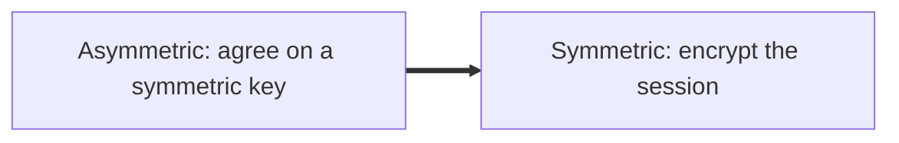

# 03 Symmetric and Asymmetric Encryption

## Overview

Encryption uses two types of keys: one shared key, or a public and private key pair. Each type suits a different job.

## Symmetric Encryption

Symmetric encryption uses the same key to both encrypt and decrypt.

| Feature | Detail |
|---|---|
| **Key usage** | One key for both locking and unlocking |
| **Speed** | Fast, because it is less computationally intense |
| **Main weakness** | The key must be shared beforehand, and an attacker who intercepts it can read everything |

> **Analogy:** Think of a patty cake game. Both players must follow the same rhythm, just as both sides must hold the same key.

**ROT13:** A simple cipher that shifts each letter by 13 places. Applying it twice returns the original text, so the same operation encrypts and decrypts, which is symmetric behaviour in its simplest form.

> [!IMPORTANT]
> **Symmetric vs Asymmetric key count:** Symmetric uses one key for both operations. Asymmetric uses two different keys.

## Asymmetric Encryption

Asymmetric encryption uses a public key and a private key. They are mathematically linked, but they differ in how they are used.

| Key | Who holds it | Role |
|---|---|---|
| **Public key** | Shared openly with anyone | Encrypts data, or verifies a signature |
| **Private key** | Never shared | Decrypts data that the public key encrypted |

> **Analogy:** The public key is an open padlock. Anyone can snap it shut on a box, but only the owner holds the key that opens it.

> [!IMPORTANT]
> **Encryption direction:** Anything encrypted with a public key can only be decrypted with its matching private key.

**Diffie-Hellman exchange:** A key exchange method that underpins how asymmetric keys are established. It is not a tested topic in depth, but it helps explain the public and private key process.

## Key Exchange and the Hybrid Model

Asymmetric encryption is slow, so it is used to set up a secure connection. Symmetric encryption then takes over for the rest of the session.

| Stage | Method | Purpose |
|---|---|---|
| **Establish the link** | Asymmetric | Securely agree on a shared symmetric key |
| **Maintain the link** | Symmetric | Encrypt the data quickly for the rest of the session |

> **Analogy:** Two people agree on a secret code using a secure phone call, then switch to the faster code for the rest of their conversation.

> [!WARNING]
> **In-band exchange:** Sending a key over the same channel as the communication. This is risky if the channel is not already secure, which is why asymmetric methods protect the key first.

## Key Length

| Algorithm | Key length | Strength |
|---|---|---|
| **AES 128** | 128 bits | Secure, weaker than AES 256 |
| **AES 256** | 256 bits | Stronger, with more possible keys to try |

> **Analogy:** Each extra bit doubles the number of keys an attacker must try, like adding more digits to a combination lock.

## Full Disk Encryption

Full disk encryption encrypts all data on a drive, so a stolen device reveals nothing without the key. It is a clear example of protecting data at rest.
