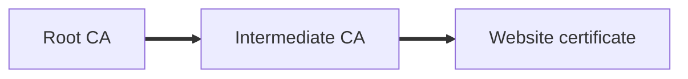

# Public Key Infrastructure and Certificates

## Overview

Public key infrastructure (PKI) uses public and private keys, and digital certificates prove that a public key belongs to who it claims to belong to.

## Digital Certificates

A certificate is issued by a certificate authority (CA) and is unique to each holder. It binds an identity to a public key.

> **Analogy:** A certificate is like a passport. The issuing government vouches for the identity printed inside it, so you can trust it without knowing the holder personally.

### Certificate Contents

| Field | What it shows |
|---|---|
| **Subject name** | The certificate holder, such as the organization and location |
| **Issuer name** | The issuing CA |
| **Validity** | The "Not before" and "Not after" dates |
| **Subject alternative names** | Every URL or domain the certificate covers |
| **Public key info** | The algorithm and key size used. The private key stays hidden |
| **Chain of trust** | The path from the certificate back to a trusted root |

> [!IMPORTANT]
> **Wildcard certificates:** A certificate for `*.example.com` covers every subdomain of that domain. Check the subject alternative names to see exactly which URLs are covered.

> **Real world:** GitHub's certificate is issued by Sectigo and is valid for about 90 days, from 30 October 2026 to 28 January 2027. This is typical of short certificate lifetimes.

## Chain of Trust

CAs get their trust from other organizations. A root CA is trusted by default by your browser, and it can vouch for intermediate CAs, which then issue certificates to websites.

> **Analogy:** It is like a diploma. A university is accredited by a national body, so the accreditation carries forward to every degree it issues.

> [!IMPORTANT]
> **Certificate signing request (CSR) vs certificate:** The CSR is the request sent to a CA, containing the public key and identity details. The certificate is what the CA issues in response. The CSR starts the signing process, so it is often a correct answer option in questions about how certificates are obtained.

## Certificate Lifecycle

1. **Request:** The holder creates a CSR with its public key and identity details.
2. **Verification:** The CA checks the holder's identity.
3. **Issuance:** The CA signs and issues the certificate.
4. **Lookup:** CAs keep records of the certificates they have issued, and offer a lookup service so others can check whether a certificate is already registered.
5. **Revocation:** If a certificate is compromised, it can be revoked before it expires.

## Certificate Revocation

| Method | How it works | Trade off |
|---|---|---|
| **OCSP** (Online Certificate Status Protocol) | Checks the status of one certificate in real time | Current, but depends on the CA responding |
| **CRL** (Certificate Revocation List) | A list of revoked certificates, downloaded periodically | Works offline, but can be out of date |

> [!WARNING]
> **OCSP vs CRL:** OCSP asks about one certificate at a time, while a CRL is a full list. Both show whether a certificate has been revoked.

## Certificate Lifetime

Certificates can last for decades in principle, but most CAs issue them for one year or three months. The expiry date is printed on the certificate itself.

## Subject Alternative Names

A single certificate can cover several related domains or group companies. For example, a large group might list all its brands on one certificate, so each one can use the same certificate.
