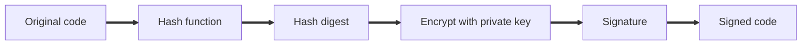

# Uses and Tools of Cryptography

## Overview

Cryptography does more than protect data in transit. It also proves where data came from and that it has not been altered.

## Code Signing

Code signing lets users verify that software came from the publisher and has not been changed since.

| Step | What happens |
|---|---|
| **Hash** | A hash function creates a digest of the original code |
| **Sign** | The publisher encrypts the digest with its private key, along with a timestamp |
| **Attach** | The signature is attached to the code |
| **Verify** | The user decrypts the signature with the publisher's public key and compares the digests |

> **Analogy:** It is like a wax seal on a letter. Only the sender has the seal, and any change to the letter breaks the match.

> [!IMPORTANT]
> **Non-repudiation:** Because only the private key can produce the signature, the publisher cannot later deny having signed the code.

## Blockchain

A blockchain is a decentralized ledger. No single authority controls it, and each record links to the one before it.

> **Analogy:** Land registry records kept at county courthouses. Every transfer of a plot is recorded, so you can trace its full history back to the start.

| Feature | How it works |
|---|---|
| **Decentralized** | Every node holds a copy of the ledger |
| **Verification** | Nodes create hash digests of new transactions and compare them |
| **Consensus** | A transaction is accepted only when the nodes agree |
| **Tamper resistance** | Changing one record would require taking over most of the network |
