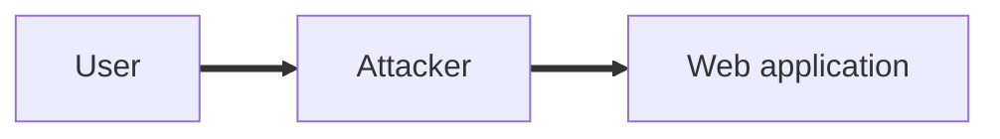

# Network and Application Attacks

## Overview

These attacks target how systems communicate and process data. They include intercepting traffic, poisoning name resolution, overwhelming services, and exploiting application memory.

## On-Path Attacks

An on-path attack, also known as a man in the middle attack, places an attacker between a user and the service they are connecting to. The attacker can read, alter, or relay the traffic.

> **Analogy:** A postman who secretly opens, reads, and reseals your letters before delivering them.

> [!IMPORTANT]
> **Exam term:** Expect the on-path attack name on the exam, rather than man in the middle.

## Poisoning Attacks

| Attack | Target | How it works |
|---|---|---|
| **DNS poisoning** | Domain name system | The attacker returns a fake IP address in place of the legitimate one |
| **ARP poisoning** | Address resolution protocol | A host on the local network pretends to be another device |

> **Analogy:** DNS poisoning is like changing the address in a phone book, so callers reach the wrong house.

## Denial of Service (DoS)

A denial of service attack overwhelms a target with too much traffic, so legitimate users cannot be served.

- **Slowloris:** Opens many connections to a web server and sends data very slowly, tying up every available connection
- **Distributed denial of service (DDoS):** Many hosts bombard one target at the same time, often hundreds or thousands of machines
- **DNS amplification:** The attacker sends small queries with a spoofed source address to open DNS servers, which send much larger replies to the victim

> **Analogy:** Slowloris is a person who holds open every checkout lane by moving through the queue one item at a time. DDoS is a crowd of people all trying to enter the same door at once.

## Application Attacks

- **Buffer overflow:** Sending more data than a memory area can hold, so the excess spills into neighbouring memory and can be used to run malicious code

> **Analogy:** Pouring more water into a glass than it holds, so it spills over onto the table.
