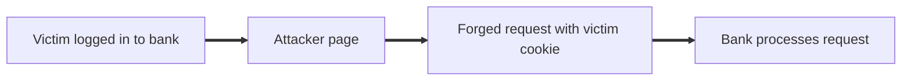

# Web and Authentication Vulnerabilities

## Overview

These vulnerabilities abuse the trust a system places in requests, file paths, and credentials. They are common exam topics because they show how an attacker can reuse or manipulate something the system already accepts.

## Cross-Site Request Forgery (CSRF)

A CSRF attack tricks a logged in victim into sending a request to a service they already trust, such as their bank, without knowing it.

1. The victim logs in to the service, which sends back a session cookie. The victim's browser keeps this cookie.
2. The attacker provides a link or page that the victim opens.
3. The forged request travels from the victim's browser, which automatically includes the cookie, so the service processes it as a genuine request.

> **Analogy:** A forged signature on a cheque that the bank accepts because the account holder is already known to be at the counter.

> [!IMPORTANT]
> **Exam clue:** The attacker does not steal the password. The attack works because the browser sends the victim's cookie automatically.

## Directory Traversal

A directory traversal attack manipulates file paths so a web server exposes files outside its intended folders. If the server is not configured to block this, it may reveal sensitive files, such as the password file on a Linux or Unix system.

> **Analogy:** A visitor who is allowed into the reception room but walks past the sign that says "Staff only" and opens every door down the corridor.

## Replay Attacks

A replay attack captures a valid authentication exchange and resends it later to gain access. The attacker does not need to know the password itself.

> **Analogy:** Recording someone unlocking a door with a code, then playing that recording back to the lock.

## Pass the Hash

Pass the hash is an attack where the adversary captures a stored password hash and uses it directly to authenticate, without knowing the plaintext password.

> [!WARNING]
> **Key point:** The server compares the hash value it receives with the one it stores. If the attacker has the matching hash, the server accepts it, so cracking the password is unnecessary.
